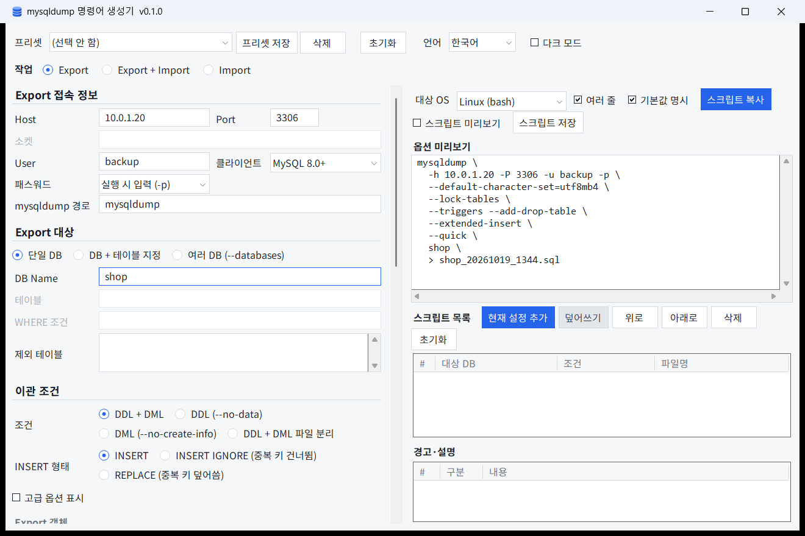
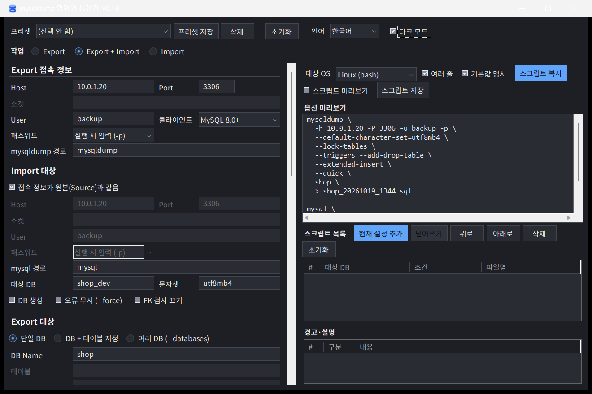

# mysqldump 명령어 생성기 — 사용 설명서

> 버전 0.1.0 기준. 화면에서 조건을 고르면 서버에서 그대로 실행할 수 있는 `mysqldump` / `mysql` 명령어와 실행 스크립트를 만들어 주는 Windows 도구입니다.
> 프로그램은 **DB 에 접속하지 않습니다.** 명령어 문자열만 만들고, 실행은 사용자가 서버에서 합니다.



## 목차

1. [설치와 실행](#1-설치와-실행)
2. [화면 구성](#2-화면-구성)
3. [기본 사용 순서](#3-기본-사용-순서)
4. [프리셋](#4-프리셋)
5. [접속 정보](#5-접속-정보)
6. [Export 대상과 이관 조건](#6-export-대상과-이관-조건)
7. [출력과 스크립트 저장](#7-출력과-스크립트-저장)
8. [Import (대상 DB 에 넣기)](#8-import-대상-db-에-넣기)
9. [스크립트 목록 (여러 작업을 한 스크립트로)](#9-스크립트-목록-여러-작업을-한-스크립트로)
10. [경고·설명 읽는 법](#10-경고설명-읽는-법)
11. [파일 구성](#11-파일-구성)
12. [자주 묻는 질문](#12-자주-묻는-질문)

---

## 1. 설치와 실행

- 배포 zip(`MysqlDumpBuilder-v0.1.0-win-x64.zip`)을 아무 폴더에나 풀고 `MysqlDumpBuilder.exe` 를 실행합니다.
- 요구 사항: Windows 10 이상. .NET 설치는 필요 없습니다 (exe 에 포함).
- 처음 실행할 때 Windows SmartScreen 경고가 뜨면 **추가 정보 → 실행** 을 누릅니다. 코드 서명을 하지 않은 프로그램이라 뜨는 경고입니다.
- 설정·프리셋·목록은 모두 exe 와 같은 폴더에 저장됩니다(포터블). 폴더를 통째로 복사하면 다른 PC 에서도 그대로 씁니다.

## 2. 화면 구성

| 위치 | 내용 |
| --- | --- |
| 맨 위 | 프리셋 선택·저장·삭제, 초기화, 언어(한국어/English), 다크 모드 |
| 맨 위 **작업** | Export / Export + Import / Import |
| 왼쪽 | 접속 정보 → (Import 대상) → Export 대상 → 이관 조건 → 고급 옵션 → 출력 |
| 오른쪽 위 | 대상 OS, 여러 줄 표시, 기본값 명시, **스크립트 복사**, 스크립트 저장, 미리보기 |
| 오른쪽 가운데 | 스크립트 목록 (여러 작업을 한 스크립트로 묶기) |
| 오른쪽 아래 | 경고·설명 (오류 / 경고 / 정보) |

- 꺼진(선택할 수 없는) 칸은 제목까지 흐린 글자로 보입니다.
- 옵션 글자색: **빨강** = 데이터 손실이나 서비스 영향이 큰 옵션(예: DROP DATABASE, 전체 읽기 잠금), **주황** = 주의가 필요한 옵션.

## 3. 기본 사용 순서

1. 접속 정보(Host, Port, User, 패스워드 방식)를 입력합니다.
2. Export 대상(DB 이름 등)과 이관 조건을 고릅니다. 오른쪽 명령어가 바로 바뀝니다.
3. **대상 OS** 를 고릅니다: Linux (bash) / Windows (cmd) / Windows (PowerShell).
4. **스크립트 복사**(Ctrl+Shift+C)로 복사해 서버 셸에 붙여 넣거나, **스크립트 저장** 으로 파일을 만듭니다.
5. 패스워드 방식이 `-p` 면 실행할 때 비밀번호를 묻습니다.

오류가 있으면 명령어 대신 "(오류를 해결하면 명령어가 생성됩니다)" 와 함께 무엇을 고쳐야 하는지 한 줄씩 나옵니다.

## 4. 프리셋

기본 프리셋 4종은 이름이 곧 내용입니다.

| 프리셋 | 내용 |
| --- | --- |
| DDL + 데이터 (전체 백업) | DB 하나를 통째로. 서비스 중단 없이(`--single-transaction`), 프로시저·이벤트·트리거 포함, `--hex-blob`, `--set-gtid-purged=OFF` |
| DDL + 데이터 (파일 분리) | 위와 같은 내용을 DDL 파일(`_ddl`)과 데이터 파일(`_data`) 두 개로 |
| DDL 오브젝트 (데이터 제외) | 테이블·뷰·프로시저·이벤트·트리거 구조만 |
| 데이터 (DDL 제외, INSERT IGNORE) | 테이블이 이미 있는 대상에 데이터만. 중복 키 건너뜀, 컬럼명 포함 |

- 기본 프리셋은 모두 **작업 = Export, 출력 = `> 파일`** 로 맞춥니다. Import 대상 설정은 건드리지 않으므로, 프리셋을 고른 뒤 작업을 Export + Import 로 바꾸면 이어서 쓸 수 있습니다.
- 일부 테이블만 빼려면 "전체 백업" 을 고른 뒤 **제외 테이블** 을 채웁니다.
- **프리셋 저장** 은 현재 화면 전체를 이름 붙여 저장합니다(`presets.json`). 접속 정보는 저장되지만 **패스워드는 절대 저장되지 않습니다.**

## 5. 접속 정보

### 패스워드 방식

| 방식 | 명령어 | 용도 |
| --- | --- | --- |
| 실행 시 입력 | `-p` | 사람이 직접 실행할 때 (기본) |
| 저장된 로그인 정보 | `--login-path=이름` | cron·작업 스케줄러 같은 자동 실행. `mysql_config_editor` 로 미리 저장 |
| 설정 파일 | `--defaults-extra-file=경로` | 자동 실행. 항상 첫 번째 인자로 놓입니다 |
| 평문 포함 | `--password=...` | 권장하지 않음. 경고가 뜨고, 프리셋·목록에는 저장되지 않습니다 |

- **User** 를 비우면 `-u` 없이 만들되 경고합니다. `-u` 가 없으면 OS 로그인 계정 이름으로 접속해 보통 Access denied 가 납니다 (login-path / 설정 파일 방식은 계정을 그쪽에서 가져오므로 경고하지 않음).

### 소켓 (localhost 접속)

리눅스 클라이언트는 Host 가 `localhost` 이거나 비어 있으면 TCP 가 아니라 **유닉스 소켓으로 접속하고 포트를 무시합니다.** `127.0.0.1` 은 TCP 입니다.

- **소켓** 칸(Host/Port 아래)은 Host 가 `localhost` 이거나 비어 있을 때만 켜집니다. 값을 넣으면 `-S <경로>` 가 붙습니다.
- 칸을 비우면 `my.cnf` 의 `[client]` 섹션 `socket=` 을 읽고(`--defaults-extra-file` 을 쓰면 그 파일도), 거기에도 없으면 클라이언트 기본 경로를 씁니다. 칸에 적은 값이 my.cnf 보다 우선합니다.
- `localhost` + 3306 이 아닌 포트 + 소켓 없음이면 경고합니다(bash 대상만). 한 서버에 인스턴스가 여럿이면 엉뚱한(보통 3306) 인스턴스로 붙을 수 있기 때문입니다. my.cnf 의 소켓이 그 포트 인스턴스 것이면 그대로 두어도 됩니다. 아니면 소켓 경로를 적거나, Host 를 `127.0.0.1` 로 바꾸거나, 고급 옵션의 **TCP 강제** 를 켭니다.
- TCP 강제를 켜면 소켓 경로는 넣지 않습니다(정보 메시지).
- Windows 클라이언트는 `localhost` 도 TCP 라서 소켓이 필요 없습니다.

### 클라이언트 버전과 경로

- **클라이언트**(MySQL 5.7 / 8.0+)에 따라 쓸 수 없는 옵션은 꺼집니다. MariaDB 는 지원하지 않습니다.
- **mysqldump 경로** 는 PATH 에 없을 때 전체 경로를 적습니다 (예: `C:\Program Files\MySQL\MySQL Server 8.0\bin\mysqldump.exe`).

## 6. Export 대상과 이관 조건

### 대상

| 모드 | 내용 |
| --- | --- |
| 단일 DB | DB 하나. **제외 테이블** 로 일부 테이블을 뺄 수 있습니다(`--ignore-table`, DB 이름은 자동으로 붙음) |
| DB + 테이블 지정 | 고른 테이블만. **WHERE 조건** 으로 행을 거를 수 있습니다 |
| 여러 DB (`--databases`) | 여러 DB 를 한 파일로. 서버 전체가 필요하면 DB 를 모두 나열합니다 (`--all-databases` 는 시스템 DB 까지 담겨 지원하지 않음) |

### 조건

| 조건 | 명령어 | 비고 |
| --- | --- | --- |
| DDL + DML | (기본) | 구조와 데이터 |
| DDL | `--no-data` | 데이터에만 관계있는 옵션(`--hex-blob`, `--complete-insert`, `--quick` 등)과 INSERT 형태, WHERE 가 잠기고 명령어에서 빠집니다 |
| DML | `--no-create-info` | 데이터만 |
| DDL + DML 파일 분리 | 명령어 2개 | 아래 참고 |

**DDL + DML 파일 분리** 는 조건 하나로 파일 두 개를 만듭니다. 구조만 먼저 넣거나 데이터만 다시 넣을 때 씁니다.

- `_ddl` 파일: `--no-data`. 테이블·뷰·루틴·이벤트·트리거.
- `_data` 파일: `--no-create-info --skip-triggers`. 데이터만 (루틴·이벤트 제외).
- 파일 이름은 템플릿의 `.sql` 앞에 접미사가 붙습니다 (예: `shop_20261015_1430_ddl.sql`, `shop_20261015_1430_data.sql`).
- Import 가 붙으면 DDL 파일을 먼저, 데이터 파일을 다음에 넣습니다.

```bash
mysql -u 계정 -p shop < shop_20261015_1430_ddl.sql    # 구조
mysql -u 계정 -p shop < shop_20261015_1430_data.sql   # 데이터 (따로 다시 넣어도 됨)
```

### INSERT 형태

INSERT / INSERT IGNORE(중복 키 건너뜀) / REPLACE(중복 키 덮어씀). 조건이 DDL 이면 잠깁니다.

### 고급 옵션

**고급 옵션 표시** 를 켜면 일관성·내용·형식·성능 옵션이 모두 보입니다. 함께 쓸 수 없는 조합(예: `--single-transaction` 과 `--lock-all-tables`)은 오류로 막고, 위험한 조합은 경고합니다. 경고 줄을 눌러 **옵션으로 이동** 하면 해당 체크박스로 갑니다.

## 7. 출력과 스크립트 저장

### 출력 방식

| 방식 | 비고 |
| --- | --- |
| `> 파일` (리다이렉션) | 기본 |
| `--result-file=파일` | Windows 권장 (PowerShell 리다이렉션의 인코딩 문제 없음) |
| `\| gzip > 파일.gz` | Linux(bash) 전용 |

- **파일명 템플릿** 토큰: `{db}` `{host}` `{date:yyyyMMdd}` `{time:HHmm}`. 아래 "미리보기" 에 실제 이름이 보입니다.

### 스크립트 저장 (.sh / .bat / .ps1)

**스크립트 저장** 은 대상 OS 에 맞는 실행 스크립트를 만듭니다. 이름은 **스크립트명 템플릿**(기본 `mysqldump_{db}`, 확장자 자동)으로 정해집니다. **스크립트 미리보기** 를 켜면 오른쪽에 스크립트 전체가 보이고, 복사도 스크립트 전체를 복사합니다.

| 대상 OS | 파일 | 특징 |
| --- | --- | --- |
| Linux (bash) | `.sh` | `set -euo pipefail`, 실패하면 오류 메시지와 종료 코드 전파, 끝나면 파일 크기·소요 시간 출력. 서버에서 `chmod +x` 필요 |
| Windows (cmd) | `.bat` | 실패하면 `exit /b` 로 종료 코드 전파 |
| Windows (PowerShell) | `.ps1` | `$LASTEXITCODE` 검사. 실행이 막히면 `powershell -ExecutionPolicy Bypass -File 파일.ps1` |

- 스크립트 안의 주석과 실행 메시지는 화면 언어와 상관없이 **영문(ASCII)** 입니다. 서버 로케일이 C/POSIX 이거나 터미널이 UTF-8 이 아니어도 깨지지 않게 하기 위해서입니다.
- 파일명의 날짜·시간은 **스크립트를 실행하는 시점** 으로 정해지고, 파일은 **스크립트를 실행한 현재 폴더** 에 생깁니다.
- 패스워드 방식이 `-p` 면 자동 실행(cron 등)에 쓸 수 없습니다. 스크립트 머리말에 안내가 들어갑니다.
- Windows PowerShell 5.1 은 값 안의 큰따옴표(`"`)를 외부 프로그램에 제대로 넘기지 못합니다. WHERE 조건에는 작은따옴표를 쓰세요 (화면에 경고가 나옵니다).

## 8. Import (대상 DB 에 넣기)



맨 위 **작업** 에서 고릅니다.

| 작업 | 하는 일 |
| --- | --- |
| Export | mysqldump 로 파일만 만듭니다 (기본) |
| Export + Import | 파일을 만든 뒤 같은 스크립트에서 바로 대상 DB 에 넣습니다. Export 가 실패하면 Import 로 넘어가지 않습니다 |
| Import | 이미 있는 파일(**읽을 파일**)을 대상 DB 에 넣습니다 |

Export 가 아닌 작업을 고르면 **Import 대상** 섹션이 나타납니다.

- **접속 정보가 원본(Source)과 같음**: 접속 칸이 잠기고 원본 접속 정보(소켓, TCP 강제 포함)를 그대로 씁니다.
- **대상 DB**: 원본 DB 이름을 따라 채워집니다. 다른 이름으로 넣으려면 고칩니다. 같은 서버의 같은 DB 로 넣어도 막지 않고(복원일 수 있으므로) 경고만 합니다.
- **읽을 파일** (Import 만 할 때): 스크립트를 실행하는 서버 기준 경로. 여러 DB 면 `{db}` 가 각 DB 이름으로 바뀝니다 (예: `backup/{db}.sql`). `.gz` 로 끝나면 `gunzip -c 파일 | mysql …` 로 넣습니다 (bash).
- **DB 생성**: `CREATE DATABASE IF NOT EXISTS` 와 `USE` 를 파일 앞에 붙여 넣습니다. 프로그램을 다시 열면 항상 꺼져 있습니다(실수 방지).
- **오류 무시 (--force)**: SQL 오류가 나도 계속 진행합니다. 일부 테이블이 빠질 수 있어 경고합니다.
- **FK 검사 끄기**: `--init-command="SET FOREIGN_KEY_CHECKS=0"`. 세션 설정이라 mysql 이 끝나면 사라지므로 되돌리는 명령은 필요 없습니다.
- 넣는 방법은 OS 마다 다릅니다: bash/cmd 는 `mysql … db < 파일`, PowerShell 은 `<` 가 없어 `mysql … --execute="source 파일"`.
- **여러 DB + Import** 는 DB 마다 mysqldump 와 mysql 을 따로 만듭니다 (`--databases` 파일에는 `USE db;` 가 들어 있어 대상 이름을 바꿀 수 없기 때문). 대상 DB 는 쉼표로 원본과 같은 순서로 적습니다 (예: 원본 `a, b, c` → 대상 `a_dev, b, c`). 개수가 다르면 오류입니다.

## 9. 스크립트 목록 (여러 작업을 한 스크립트로)

- **현재 설정 추가** 로 지금 화면 설정을 한 항목씩 담습니다. 목록에 항목이 있으면 스크립트 복사·저장은 목록 전체를 순서대로 냅니다 (하나라도 실패하면 거기서 멈춤).
- 항목을 더블클릭(또는 Enter)하면 명령어 전체가 팝업으로 보이고, **왼쪽에 불러오기** 로 화면에 올려 고칠 수 있습니다. 고친 뒤 **덮어쓰기** 로 되돌려 넣습니다.
- **위로 / 아래로** 로 순서를 바꾸고 **초기화** 로 비웁니다.
- mysqldump 경로·대상 OS·여러 줄 표시는 목록 공통으로 현재 화면 값을 따르고, 접속 정보와 옵션은 항목마다 저장됩니다.
- 오른쪽 미리보기는 화면 설정이 목록의 한 항목과 같을 때만 목록 전체("스크립트 미리보기 (N건)")를, 아니면 화면 설정("옵션 미리보기")을 보여 줍니다. 복사·저장도 보이는 그대로입니다.
- 목록은 `batch.json` 에 자동 저장됩니다. 항목이 둘 이상이면 스크립트 파일명의 `{db}` 는 `batch` 가 됩니다.

## 10. 경고·설명 읽는 법

| 구분 | 의미 |
| --- | --- |
| 오류 (빨강) | 명령어를 만들지 않습니다. 고쳐야 합니다 |
| 경고 (주황) | 명령어는 만들지만 확인이 필요합니다 |
| 정보 | 프로그램이 자동으로 한 일을 알려 줍니다 |

- `#` 번호는 메시지가 처음 나타난 순서이고 큰 번호가 위로 옵니다. 방금 바꾼 설정 때문에 생긴 줄이 맨 위에 보입니다.
- 줄을 클릭하면 전체 글이 팝업으로 보이고, 옵션과 연결된 줄이면 **옵션으로 이동** 할 수 있습니다.
- Import 쪽 메시지는 `[Import]`, 목록 항목 메시지는 `[목록 N]` 이 앞에 붙습니다.

## 11. 파일 구성

| 파일 | 설명 |
| --- | --- |
| `MysqlDumpBuilder.exe` | 프로그램 본체 |
| `options.schema.json` | 옵션 정의(라벨·설명·기본값·충돌 규칙). 고치면 코드 없이 옵션을 바꿀 수 있고, 지워도 내장 기본값으로 동작합니다 |
| `presets.json` | 사용자 프리셋 (자동 생성) |
| `batch.json` | 스크립트 목록 (자동 생성) |
| `settings.json` | 언어·창 크기·다크 모드·마지막 입력 상태 (자동 생성, 패스워드 제외) |

## 12. 자주 묻는 질문

**Q. 프로그램이 DB 에 직접 접속하나요?**
아니요. 명령어와 스크립트 문자열만 만듭니다. 실행은 사용자가 서버에서 합니다.

**Q. 패스워드가 어딘가에 저장되나요?**
아니요. 프리셋·목록·설정 파일 어디에도 저장되지 않습니다. "평문 포함" 방식으로 입력한 값도 화면에만 있다가 사라집니다.

**Q. cron 으로 자동 실행하고 싶습니다.**
패스워드 방식을 `--login-path` 또는 `--defaults-extra-file` 로 바꾸고 bash 스크립트로 저장하세요. `-p` 는 입력을 기다리므로 자동 실행에서 멈춥니다.

**Q. `localhost` 에 포트를 3307 로 줬는데 3306 인스턴스가 덤프됐습니다.**
리눅스 클라이언트는 `localhost` 면 소켓으로 붙고 포트를 무시합니다. 소켓 칸에 3307 인스턴스의 소켓 경로를 적거나, Host 를 `127.0.0.1` 로 바꾸거나, TCP 강제를 켜세요. ([5. 접속 정보](#소켓-localhost-접속) 참고)

**Q. 스크립트 메시지가 왜 영어인가요?**
서버 로케일·터미널 인코딩에 따라 한글이 깨지기 때문에 스크립트 안은 모두 ASCII 로 씁니다.

**Q. PowerShell 에서 WHERE 조건이 깨집니다.**
Windows PowerShell 5.1 은 큰따옴표를 외부 프로그램에 제대로 넘기지 못합니다. 조건 안의 문자열은 작은따옴표로 쓰세요.

**Q. 설정을 처음 상태로 되돌리고 싶습니다.**
맨 위 **초기화** 는 접속 정보를 남기고 옵션만 되돌립니다. 완전히 처음으로 돌리려면 프로그램을 닫고 `settings.json` 을 지웁니다.

**Q. 필요한 옵션이 화면에 없습니다.**
`options.schema.json` 에 항목을 추가하면 체크박스가 생깁니다. 형식은 저장소 README 의 "옵션을 추가하려면" 을 참고하세요.
